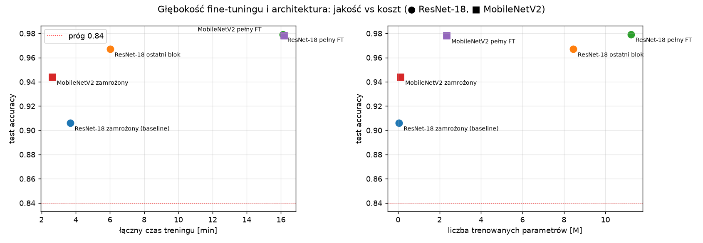
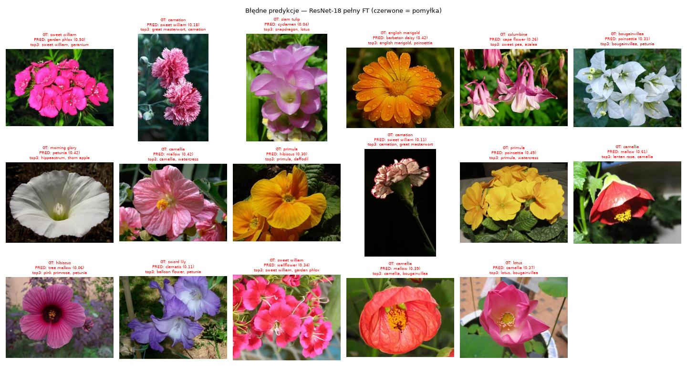

# Temat 2: Klasyfikacja gatunków kwiatów (fine-grained) — Oxford Flowers 102

Autorka: Katarzyna Batko

Fine-grained klasyfikacja 102 gatunków kwiatów. Porównujemy baseline (ResNet-18, wagi ImageNet, zamrożone ciało + nowa głowa) z wariantami o różnej głębokości fine-tuningu oraz z lżejszą architekturą MobileNetV2. Wszystkie modele trenowano na tym samym podziale danych i z tym samym ziarnem.

**Wynik główny:** najlepszy model (ResNet-18, pełny fine-tuning) osiąga **accuracy 0.979, macro-F1 0.980 i top-3 0.994** na zbiorze testowym. Próg 0.84 przekracza każdy z 5 wariantów, łącznie z baseline'em (0.906).

**Weights & Biases:** projekt [`oxford-flowers102-finetuning`](https://forge.coreweave.com/wandb/metashi-dsw/oxford-flowers102-finetuning) (wszystkie 5 runów). Run najlepszego modelu: [`r18_full`](https://forge.coreweave.com/wandb/metashi-dsw/oxford-flowers102-finetuning/runs/v02twozh); baseline: [`r18_frozen`](https://forge.coreweave.com/wandb/metashi-dsw/oxford-flowers102-finetuning/runs/76hn6p29).

---

## 1. Uruchomienie krok po kroku

Testowano na Apple M4 (MPS). Kod sam wybiera urządzenie w kolejności CUDA > MPS > CPU.

```bash
# 1. środowisko
python3 -m venv .venv && source .venv/bin/activate
pip install -r requirements.txt

# 2. dane: pobranie z Kaggle (kagglehub), etykiety z Oxford VGG, cache 256 px, podział 80/10/10
cd src
python data.py            # tworzy splits/split_seed6102.csv i sprawdza rozłączność splitów

# 3. analiza danych → figures/eda_*.png, results/data_stats.json
python analyze_data.py

# 4. trening 5 wariantów + ewaluacja zbiorcza (~45 min na M4, ok. 15–25 min na GPU CUDA)
WANDB_MODE=offline PYTHON=python ./run_all.sh
#   albo pojedynczo:  python train.py --run r18_full
#   szybki test:      python train.py --run r18_frozen --epochs 1 --subset 256
python metrics.py         # test jednostkowy własnego licznika top-k

# 5. W&B: po `wandb login` można trenować online albo wysłać runy offline:
wandb sync wandb/offline-run-*
#   następnie w ustawieniach projektu na wandb.ai: Visibility → Public

# 6. demo
jupyter notebook ../notebooks/dsw63838_02_gatunkikwiatow.ipynb

# 7. proof of concept (~15 s) i testy (18 testów, ~15–20 s) — szczegóły w test/README.md
cd .. && python test/poc.py && python -m pytest test -q
```

Na CPU trening pełnego fine-tuningu trwa wielokrotnie dłużej. W ramach budżetu 4 h CPU warto ograniczyć się do wariantów `r18_frozen`, `r18_last_block` i `mnv2_frozen`.

Do repozytorium **nie** trafiają dane (`data/`), wagi (`checkpoints/*.pt`), `wandb/`, `__pycache__/` ani `.venv/` (patrz `.gitignore`). Checkpointy potrzebne w demo powstają w kroku 4.

### Struktura

| plik | rola |
|---|---|
| `src/config.py` | seed 6102, ścieżki, hiperparametry wszystkich wariantów |
| `src/data.py` | pobranie danych, etykiety, stratyfikowany podział 80/10/10, `Dataset`, augmentacja |
| `src/models.py` | `build_model(arch, finetune)`, gdzie finetune to `frozen` / `last_block` / `full` |
| `src/metrics.py` | **własny `TopKCounter`** (top-k accuracy bez gotowych funkcji metryk), macro-F1, confusion matrix |
| `src/train.py` | pętla treningowa, logowanie do W&B, wybór najlepszej epoki po val accuracy, ewaluacja na teście |
| `src/analyze_data.py` | EDA |
| `src/evaluate.py` | tabela wyników, wykresy, confusion matrix, analiza błędów |
| `notebooks/dsw63838_02_gatunkikwiatow.ipynb` | notebook: analiza danych, wyniki, eksperyment, analiza błędów i demo predykcji top-3 |
| `figures/`, `results/`, `splits/` | wykresy, metryki (json/csv), plik podziału |

---

## 2. Dane

- **Źródło:** Kaggle `waseemalastal/the-oxford-flowers-102-dataset` (8 189 zdjęć). W tej wersji zdjęcia testowe nie mają etykiet. Etykiety dla wszystkich 8 189 zdjęć pochodzą więc z oficjalnego `imagelabels.mat` (Oxford VGG). Zgodność sprawdziłam: na 7 370 zdjęciach z podpisanych folderów train/valid jest 0 rozbieżności.
- **Podział:** własny, stratyfikowany 80/10/10 na całych 8 189 zdjęciach (`train_test_split`, `random_state=6102`). Wynik to **6 551 / 819 / 819**, a każda ze 102 klas występuje w każdej części. Lista plików jest w `splits/split_seed6102.csv` i odtwarza się bit w bit (sprawdzone sumą MD5). Oryginalnego podziału Oxford (1 020 zdjęć treningowych) nie używamy, bo zadanie wymaga 80/10/10.
- **Rozkład klas** (`figures/eda_class_distribution.png`): od 40 do 258 zdjęć na klasę, średnia 80, mediana 66, stosunek największej klasy do najmniejszej 6,5:1. Największe klasy to petunia (258), passion flower (251), wallflower i water lily; najmniejsze (po 40) to m.in. pink primrose, moon orchid i fire lily. Zbiór jest niezbalansowany, dlatego obok accuracy raportujemy **macro-F1**.
- **Rozmiary obrazów** (`figures/eda_image_sizes.png`): krótszy bok prawie zawsze ma 500 px, dłuższy 500–1 168 px, średnie proporcje 1,21. Obrazy są wcześniej przeskalowane do krótszego boku 256 px (cache), co skraca dekodowanie JPEG w każdej epoce.
- **Wizualizacje:** `eda_class_grid.jpg` (po jednym przykładzie z każdej klasy) i `eda_intra_class_variation.jpg`. Na tym drugim widać główną trudność zbioru: duża zmienność wewnątrz klasy (sword lily występuje w kolorze żółtym, białym, fioletowym i różowym; petunia w czerwonym, białym i różowym) przy małych różnicach między niektórymi klasami.

## 3. Modele i trening

Wspólne ustawienia: wagi ImageNet (`torchvision`), wejście 224×224, normalizacja ImageNet, batch 64, AdamW (weight decay 1e-4), harmonogram OneCycle (10% rozgrzewki, potem spadek kosinusowy), label smoothing 0,1. Do ewaluacji na teście wybieramy checkpoint z najlepszą val accuracy.

Augmentacja treningowa: `RandomResizedCrop(224, scale=0.6–1)`, odbicie w poziomie, `ColorJitter(0.2, 0.2, 0.2)`. Walidacja i test: `CenterCrop(224)`.

W zamrożonych częściach sieci BatchNorm pozostaje w trybie `eval`, żeby statystyki ImageNet nie „dryfowały” przy trenowaniu samej głowy.

| wariant | co trenujemy | lr głowa / ciało | epoki |
|---|---|---|---|
| `r18_frozen` (**baseline**) | tylko nowa warstwa `fc` | 1e-3 / — | 10 |
| `r18_last_block` | `layer4` + `fc` | 1e-3 / 3e-4 | 10 |
| `r18_full` | cała sieć, mały lr dla ciała | 1e-3 / 1e-4 | 12 |
| `mnv2_frozen` | tylko klasyfikator | 1e-3 / — | 10 |
| `mnv2_full` | cała sieć | 1e-3 / 1e-4 | 12 |

Seed 6102 ustawiamy dla `random`, `numpy`, `torch` i `torch.mps`. Kolejność batchy wyznacza generator z tym samym ziarnem, więc każdy wariant widzi te same dane w tym samym porządku.

> Uwaga o wymaganiu „baseline trenowany od zera”: temat wprost definiuje baseline jako *ResNet-18 z wagami ImageNet, zamrożone ciało + nowa warstwa wyjściowa*, więc zgodnie z klauzulą „chyba że temat stanowi inaczej” baseline używa wag ImageNet. Od zera trenowana jest tylko nowa głowa. Nie użyto żadnych wag z Kaggle ani z innych repozytoriów.

### Metryki

- **accuracy** (top-1)
- **macro-F1**: średnia F1 po klasach, każda klasa waży tyle samo, niezależnie od liczności
- **top-3 accuracy** (dodatkowo top-5)

Top-k liczy **własnoręczny** licznik `TopKCounter` w `src/metrics.py`. Sortuje logity (`argsort`), sprawdza, czy prawdziwa klasa jest wśród k pierwszych, i akumuluje trafienia po batchach. Ma test jednostkowy na ręcznie policzonym przykładzie (`python src/metrics.py`). Ten sam licznik daje top-1 accuracy w trakcie treningu.

## 4. Wyniki (zbiór testowy, 819 zdjęć)

| wariant | trenowane param. | czas treningu | czas/epokę | latencja CPU (bs=1) | **accuracy** | **macro-F1** | **top-3** | top-5 |
|---|---:|---:|---:|---:|---:|---:|---:|---:|
| ResNet-18 zamrożony (**baseline**) | 0,05 M | 220 s | 22 s | 20 ms | 0,906 | 0,893 | 0,970 | 0,987 |
| ResNet-18 ostatni blok | 8,45 M | 360 s | 36 s | 20 ms | 0,967 | 0,966 | **0,998** | 0,999 |
| ResNet-18 pełny FT | 11,23 M | 967 s | 81 s | 20 ms | **0,979** | **0,980** | 0,994 | 0,998 |
| MobileNetV2 zamrożony | 0,13 M | 158 s | 16 s | 44 ms | 0,944 | 0,934 | 0,987 | 0,994 |
| MobileNetV2 pełny FT | 2,35 M | 971 s | 81 s | 44 ms | 0,978 | 0,976 | 0,996 | 0,998 |

Pełna tabela jest w `results/summary.md`, metryki per run w `results/*.json`, a F1 dla każdej klasy w `results/per_class_metrics.csv`. Łączny czas treningu wszystkich wariantów to **~45 min na GPU (Apple MPS)**, czyli w budżecie 2 h.

Wykresy: `figures/training_curves.png`, `figures/train_vs_val_accuracy.png`, `figures/test_metrics.png`, `figures/quality_vs_cost.png`.

Próg 0,84 osiąga każdy wariant. Poniżej omówienie, co zmienia głębokość fine-tuningu i dlaczego.

## 5. Eksperyment: głębokość fine-tuningu (zamrożone vs ostatni blok vs całość)



| ResNet-18 | accuracy | macro-F1 | czas | Δ acc vs poprzedni | Δ czasu |
|---|---:|---:|---:|---:|---:|
| zamrożony | 0,906 | 0,893 | 3,7 min | — | — |
| ostatni blok | 0,967 | 0,966 | 6,0 min | **+6,1 pp** | ×1,6 |
| całość | 0,979 | 0,980 | 16,1 min | +1,2 pp | ×2,7 |

**Co się zmienia i dlaczego:**

1. **Zamrożone ciało (0,906).** Cechy ImageNet są ogólne: ResNet-18 nauczył się odróżniać „kwiat” od „psa”, a nie „sweet william” od „carnation”. Głowa liniowa może tylko ważyć gotowe cechy z ostatniej warstwy. To wystarcza na łatwe, wyraziste gatunki, ale nie na pary różniące się detalem. Widać to po macro-F1 (0,893), niższym od accuracy: 14 klas ma F1 < 0,8, wszystkie z grupy gatunków podobnych do siebie. Krzywe pokazują też, że model **nie przeucza się** (train ≈ val ≈ 0,90). Ogranicza go pojemność reprezentacji, a nie dane.
2. **Ostatni blok (`layer4`, 0,967).** Największy skok jakości, +6 pp przy zaledwie 1,6 razy dłuższym treningu. `layer4` koduje cechy najwyższego poziomu: części obiektu i tekstury. To właśnie je trzeba „przestroić” z kategorii ImageNet na detale kwiatów (kształt płatków, układ pręcików, wzór żyłek). Niższe warstwy (krawędzie, kolory, proste tekstury) są uniwersalne i nie wymagają zmian. Najwięcej zyskują klasy podobne do siebie: siam tulip (F1 0,50 → 0,86 w pełnym FT), primula (0,43 → 0,89), garden phlox (0,50 → 0,89).
3. **Cała sieć (0,979).** Kolejne +1,2 pp accuracy i +1,4 pp macro-F1 kosztuje 2,7 razy więcej czasu. Dostrojenie wcześniejszych warstw pomaga mniej, bo ich cechy i tak dobrze się przenoszą. Train accuracy dochodzi do 1,00 przy val ≈ 0,98, czyli model zaczyna się „uczyć na pamięć”. Mały lr dla ciała (1e-4, 10 razy mniejszy niż dla głowy) i label smoothing utrzymują to w ryzach, ale przy większej liczbie epok byłoby ryzyko przeuczenia. Ciekawostka: top-3 jest najlepsze dla wariantu „ostatni blok” (0,998 wobec 0,994). Pełny FT jest bardziej pewny siebie i przy błędzie częściej wypycha prawdziwą klasę poza top-3. Różnica dotyczy jednak 3 zdjęć z 819 i mieści się w szumie.

**Wniosek z eksperymentu:** przy ~6,5 tys. zdjęć **odmrożenie ostatniego bloku daje ~83% zysku pełnego fine-tuningu** (6,1 z 7,3 pp) przy ~37% jego czasu. Pełny FT opłaca się tylko wtedy, gdy liczy się ostatni punkt procentowy.

### Porównanie architektur: ResNet-18 vs MobileNetV2

- **MobileNetV2 ma 4,8 razy mniej parametrów** (2,35 M wobec 11,2 M) i ~6 razy mniej FLOPs (0,3 wobec 1,8 GFLOPs), a w wersji pełnej osiąga praktycznie ten sam wynik (0,978 wobec 0,979; różnica to 1 zdjęcie).
- **Zamrożony MobileNetV2 jest wyraźnie lepszy od zamrożonego ResNet-18** (0,944 wobec 0,906) i trenuje się najszybciej (2,6 min). Jego wektor cech przed klasyfikatorem ma 1 280 wymiarów zamiast 512, więc liniowa głowa ma bogatszą reprezentację do dyspozycji.
- **Pułapka „lekkiej” architektury:** mniej FLOPs nie oznacza automatycznie mniejszej latencji. Na CPU w PyTorch (bs=1) MobileNetV2 potrzebuje **44 ms, a ResNet-18 20 ms**, a czas epoki pełnego FT na MPS jest taki sam (~81 s). Konwolucje depthwise są w tych backendach słabo zoptymalizowane i ograniczone przepustowością pamięci, nie mocą obliczeniową. Przewaga MobileNetV2 ujawnia się w rozmiarze modelu (~9 MB wobec ~45 MB) i na dedykowanych runtime'ach mobilnych (TFLite, CoreML), do których ta architektura została zaprojektowana.

> Uwaga o czasach: pomiary czasu na MPS są zaszumione. Czas epoki tego samego wariantu wahał się od 53 do 131 s (throttling termiczny, inne procesy w tle). Latencję mierzymy dlatego dodatkowo na CPU, niezależnie od wag, bo zależy wyłącznie od architektury.

## 6. Analiza błędów

Najlepszy model (ResNet-18, pełny FT) myli się na **17 z 819** zdjęć testowych. W 71% tych błędów prawdziwa klasa jest w top-3. Średnia pewność (softmax) wynosi 0,82 dla trafnych predykcji i 0,31 dla błędnych, więc model „wie”, kiedy nie wie. Można to wykorzystać do odrzucania niepewnych predykcji.

- Confusion matrix: `figures/confusion_matrix_best.png` (najlepszy model) i `figures/confusion_matrix_baseline.png` (baseline). Obie są znormalizowane wierszami.
- Błędne predykcje: `figures/errors_best_model.jpg`, `figures/errors_baseline.jpg`; poprawne: `figures/correct_predictions_best_model.jpg`.
- Najczęściej mylone pary z przykładami: `figures/confused_pairs_examples.jpg`.
- Najsłabsze klasy: `figures/worst_classes.png`.



**Najczęściej mylone pary (najlepszy model):** camellia ↔ mallow (3), sweet william ↔ carnation (2), oraz po jednym błędzie: petunia ↔ morning glory, siam tulip ↔ cyclamen, hibiscus ↔ tree mallow, sweet william ↔ wallflower / garden phlox, english marigold ↔ barbeton daisy, poinsettia ↔ primula / bougainvillea, sword lily ↔ clematis.

### Mała liczba przykładów czy istota problemu?

Sprawdziliśmy korelację Spearmana między F1 klasy na teście a liczbą jej zdjęć treningowych (`figures/per_class_f1_vs_train_count.png`):

| wariant | ρ (F1 vs liczność) | p |
|---|---:|---:|
| ResNet-18 zamrożony | −0,03 | 0,76 |
| ResNet-18 ostatni blok | −0,11 | 0,27 |
| ResNet-18 pełny FT | −0,31 | 0,002 |
| MobileNetV2 zamrożony | +0,05 | 0,65 |
| MobileNetV2 pełny FT | −0,13 | 0,18 |

**Liczba przykładów nie tłumaczy błędów.** W żadnym wariancie korelacja nie jest dodatnia, a w najlepszym modelu jest nawet istotnie **ujemna**. Klasy z błędami mają medianę 73,5 zdjęć treningowych, klasy bez błędów tylko 50. Najmniejsze klasy (po ~32 zdjęcia treningowe, np. pink primrose, moon orchid) są rozpoznawane bezbłędnie, bo są wizualnie unikatowe. Błędy wynikają natomiast z:

1. **Rzeczywistego podobieństwa gatunków (istota problemu).** Większość mylonych par to rośliny blisko spokrewnione albo zbieżne wizualnie. Sweet william i carnation to dwa gatunki goździka (*Dianthus barbatus* i *D. caryophyllus*) o identycznie postrzępionych płatkach. Hibiscus i tree mallow należą do tej samej rodziny ślazowatych, mają lejkowaty kwiat z ciemnym środkiem. Siam tulip i cyclamen to różowe, wydłużone płatki widziane z boku. English marigold i barbeton daisy to pomarańczowe „stokrotki”.
2. **Dużej zmienności wewnątrz klasy.** Największe klasy (petunia, hibiscus, primula) występują w wielu kolorach i kadrach, więc ich rozkład wizualny nachodzi na kilka innych klas. Stąd ujemna korelacja: więcej zdjęć często oznacza bardziej heterogeniczną klasę, a nie łatwiejszą.
3. **Szumu w etykietach.** Wszystkie 3 błędy „camellia → mallow” dotyczą zdjęć, które na oko przedstawiają **abutilon** (zwisający dzwonkowaty kwiat z wystającym słupkiem), czyli właśnie klasę „mallow”. Model ma tu najprawdopodobniej rację, a etykieta zbioru jest błędna (ocena na podstawie oględzin zdjęć, nie weryfikacji botanicznej). Część z 2% błędów to więc granica wyznaczona przez jakość danych, a nie przez model.
4. **Kadru i kontekstu.** Kilka błędów to zdjęcia z nietypową perspektywą (kwiat widziany z boku, fragment kwiatostanu, mocne zbliżenie), w których brakuje cechy rozróżniającej, np. liści czy pokroju całej rośliny.

Porównanie z baseline'em potwierdza ten obraz. Zamrożony model myli te same „trudne” rodziny (goździki, ślazowate, petunia/bougainvillea), tylko znacznie częściej (77 błędów). Fine-tuning naprawia większość z nich, ale para goździków i para camellia/mallow zostają, bo tam ograniczeniem są dane, a nie pojemność modelu.

## 7. Wnioski

**Co działało i dlaczego**
- Transfer learning z ImageNet: nawet zamrożone cechy dają 0,906, a dostrojenie wyższych warstw podnosi wynik do ~0,98. Przy 6,5 tys. zdjęć trenowanie od zera nie miałoby szans na taki wynik.
- Odmrożenie ostatniego bloku daje najlepszy stosunek jakości do kosztu.
- Mały lr dla wstępnie wytrenowanego ciała (10 razy mniejszy niż dla głowy), OneCycle z rozgrzewką i label smoothing: pełny FT nie „psuje” wag ImageNet w pierwszych krokach i nie przeucza się mimo train acc = 1,0.
- Zamrażanie BatchNorm w zamrożonych częściach sieci i stratyfikowany podział, dzięki któremu każda klasa jest w teście.

**Ograniczenia**
- Zbiór testowy ma 819 zdjęć, czyli ~8 na klasę. Różnica 0,1 pp to jedno zdjęcie, więc różnice między pełnym FT ResNet-18 i MobileNetV2 (0,979 wobec 0,978) są nieistotne. Pojedyncze F1 per klasa są bardzo zaszumione (jedna pomyłka w klasie z 4 zdjęciami testowymi obniża jej F1 do ~0,75–0,89).
- Jeden seed (zgodnie ze specyfikacją). Brak przedziałów ufności z wielu powtórzeń.
- Czasy treningu na Apple MPS są niestabilne (throttling), a latencja na CPU nie odpowiada latencji na urządzeniach mobilnych.
- Szum w etykietach (camellia/mallow) zawyża liczbę błędów i jednocześnie uczy model złych granic.

**Co zrobilibyśmy inaczej**
- Kilka seedów albo walidacja krzyżowa, żeby ocenić istotność różnic między najlepszymi wariantami.
- Rozmrażanie stopniowe (gradual unfreezing) albo dyskryminatywne lr per blok zamiast wyboru 0/1/całość.
- Wyższa rozdzielczość wejścia (np. 320–448 px), bo detale typu pręciki giną przy 224 px. Do tego test-time augmentation (odbicie, kilka cropów).
- Przegląd i poprawa podejrzanych etykiet (np. przez przejrzenie zdjęć o wysokiej pewności modelu sprzecznej z etykietą).
- Mocniejsze augmentacje (RandAugment, Mixup/CutMix) i nowocześniejsze sieci (EfficientNet, ConvNeXt-T, ViT) przy większym budżecie.

**Zastosowanie praktyczne.** Model tego typu nadaje się do aplikacji rozpoznających rośliny (ogrodnictwo, edukacja przyrodnicza, katalogowanie zielników, monitoring bioróżnorodności). Dla takiej aplikacji lepiej pokazywać **top-3 z prawdopodobieństwami** (top-3 ≈ 0,99–0,998) niż jedną odpowiedź. Przy niskiej pewności (< ~0,4) należy prosić o drugie zdjęcie, np. liści albo całej rośliny: błędne predykcje mają średnią pewność 0,31, a trafne 0,82. Na urządzenie mobilne wybralibyśmy MobileNetV2 (pełny FT): ta sama jakość przy 4,8 razy mniejszym modelu, uruchamiany przez CoreML/TFLite. Na serwer wystarczy ResNet-18 z odmrożonym ostatnim blokiem, jeśli liczy się szybkie przetrenowanie na nowych gatunkach.

## 8. Demo

`notebooks/dsw63838_02_gatunkikwiatow.ipynb` (zapisany z wynikami) przechodzi przez cały projekt w kolejności wymagań z zadania:
- dane: liczba przykładów, rozkład klas, rozmiary obrazów, siatka klas, zmienność wewnątrz klasy,
- tabela wyników wszystkich wariantów z progiem 0,84 i krzywe treningowe,
- eksperyment z głębokością fine-tuningu (jakość vs czas treningu),
- ewaluacja najlepszego checkpointu na żywo z **własnym `TopKCounter`** (wynik zgadza się z `results/`),
- analiza błędów: confusion matrix z powiększeniem na mylone klasy, mylone pary (najlepszy model vs baseline), błędne predykcje obok przykładu przewidzianej klasy, pewność trafnych vs błędnych, korelacja F1 z licznością klasy,
- demo: predykcje top-3 na losowych zdjęciach testowych i na własnym zdjęciu (zmienna `my_image`).
